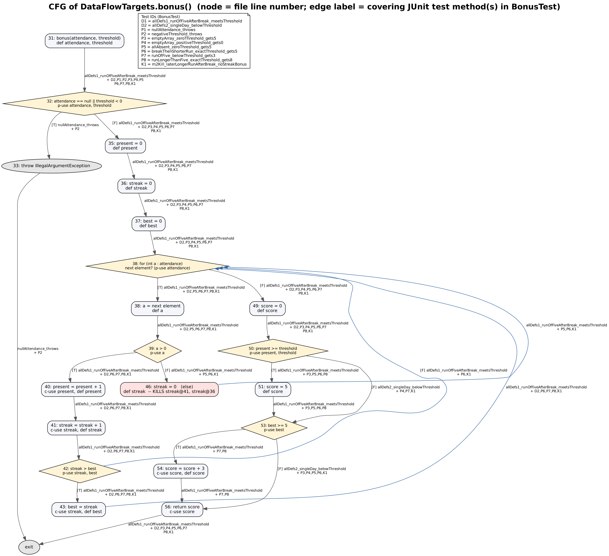

# Лаборатори №10: Өгөгдлийн урсгалын тест — Definition-Use хосууд

F.CSA313 — Программ хангамжийн чанарын баталгаа ба тест (2026)

- **Нэр:** Мэндамар
- **Оюутны код:** ＿＿＿＿＿＿

## Орчин

`results/` доторх бүх гаралт дараах орчинд үүссэн (Linux, OpenJDK 21, Maven 3.9.16):

```
$ java -version
openjdk version "21.0.12.1" 2026-08-18
OpenJDK Runtime Environment (build 21.0.12.1+1-1-24.04.4-Ubuntu)
OpenJDK 64-Bit Server VM (build 21.0.12.1+1-1-24.04.4-Ubuntu, mixed mode, sharing)

$ mvn -version
Apache Maven 3.9.16 (2bdd9fddda4b155ebf8000e807eb73fd829a51d5)
Maven home: /opt/mvn3916
Java version: 21.0.12.1, vendor: Ubuntu, runtime: /usr/lib/jvm/java-21-openjdk-amd64
Default locale: en_US, platform encoding: UTF-8
OS name: "linux", version: "6.18.44-fc-v445", arch: "amd64", family: "unix"
```

**Ажиллуулах:** `mvn verify` → 15 тест (`GcdTest` 4, `BonusTest` 11), бүгд ногоон, `target/site/jacoco/` тайлан үүснэ.

**Мөрийн дугаарлалт.** Бүх мөрийн дугаар нь `src/main/java/mn/edu/must/sqat/DataFlowTargets.java` файлынх (лекцийн 1–8 → 13, 15, 16, 17, 18, 20). p-use-ийг ирмэгээр `(шийдвэрийн мөр, дараагийн мөр)` гэж бичив; жишээ нь `(42,38)` нь 42-р мөрийн нөхцөл FALSE болоод давталтын толгой 38 руу буцах ирмэг.

**Тестийн ID-ууд:**

| ID | Тестийн метод | Оролт → хүлээгдэх утга |
|---|---|---|
| G1 | `GcdTest.zeroIterations_7_0` | gcd(7,0) → 7 (0 давталт) |
| G2 | `GcdTest.oneIteration_0_5` | gcd(0,5) → 5 (1 давталт) |
| G3 | `GcdTest.twoIterations_12_8` | gcd(12,8) → 4 (2 давталт) |
| G4 | `GcdTest.swapFirstIteration_8_12` | gcd(8,12) → 4 (3 давталт) |
| D1 | `BonusTest.allDefs1_runOfFiveAfterBreak_meetsThreshold` | [1,1,0,1,1,1,1,1], 3 → 8 |
| D2 | `BonusTest.allDefs2_singleDay_belowThreshold` | [1], 5 → 0 |
| P1 | `BonusTest.nullAttendance_throws` | null, 1 → IAE |
| P2 | `BonusTest.negativeThreshold_throws` | [], −1 → IAE |
| P3 | `BonusTest.emptyArray_zeroThreshold_gets5` | [], 0 → 5 |
| P4 | `BonusTest.emptyArray_positiveThreshold_gets0` | [], 1 → 0 |
| P5 | `BonusTest.allAbsent_zeroThreshold_gets5` | [0,0,0], 0 → 5 |
| P6 | `BonusTest.breakThenShorterRun_exactThreshold_gets5` | [1,0,1], 2 → 5 |
| P7 | `BonusTest.runOfFive_belowThreshold_gets3` | [1,1,1,1,1], 6 → 3 |
| P8 | `BonusTest.runLongerThanFive_exactThreshold_gets8` | [1,1,1,1,1,1,1], 7 → 8 |
| K1 | `BonusTest.m2Kill_laterLongerRunAfterBreak_noStreakBonus` | [1,1,0,1,1,1], 10 → 0 (Хэсэг C) |

---

## Хэсэг A: gcd — бүрэн DU хүснэгт

### Def/Use (gcd)

```java
13: public static int gcd(int x, int y)  // def x, def y
14:     int tmp;                           // зөвхөн зарлалт — def биш (утга оноогоогүй)
15:     while (y != 0)                     // p-use y
16:         tmp = x % y;                   // c-use x, c-use y; def tmp
17:         x = y;                         // c-use y; def x
18:         y = tmp;                       // c-use tmp; def y
20:     return x;                          // c-use x
```

Def-үүд: x@13, x@17, y@13, y@18, tmp@16 (5 def) → **13 DU хос**, бүгд биелэх боломжтой.

| # | Хувьсагч | Def мөр | Use мөр | c-use/p-use | Def-clear зам | Тестийн ID | Хамрагдсан эсэх |
|---|---|---|---|---|---|---|---|
| 1 | x | 13 | 16 | c-use | 13→15(T)→16 | G2, G3, G4 | Тийм |
| 2 | x | 13 | 20 | c-use | 13→15(F)→20 | **G1** | Тийм |
| 3 | x | 17 | 16 | c-use | 17→18→15(T)→16 | G3, G4 | Тийм |
| 4 | x | 17 | 20 | c-use | 17→18→15(F)→20 | G2, G3, G4 | Тийм |
| 5 | y | 13 | (15,16) | p-use | 13→15→16 | G2, G3, G4 | Тийм |
| 6 | y | 13 | (15,20) | p-use | 13→15→20 | **G1** | Тийм |
| 7 | y | 13 | 16 | c-use | 13→15→16 | G2, G3, G4 | Тийм |
| 8 | y | 13 | 17 | c-use | 13→15→16→17 | G2, G3, G4 | Тийм |
| 9 | y | 18 | (15,16) | p-use | 18→15→16 | G3, G4 | Тийм |
| 10 | y | 18 | (15,20) | p-use | 18→15→20 | G2, G3, G4 | Тийм |
| 11 | y | 18 | 16 | c-use | 18→15→16 | G3, G4 | Тийм |
| 12 | y | 18 | 17 | c-use | 18→15→16→17 | G3, G4 | Тийм |
| 13 | tmp | 16 | 18 | c-use | 16→17→18 | G2, G3, G4 | Тийм |

Def-clear байдлын тайлбар: x@13-аас 16 хүрэх замд x-ийг дахин тодорхойлох 17-р мөр ордоггүй (16 нь 17-оос өмнө), харин x@17 → 16 зам нь 18 ба 15-аар дамжаад x-ийг дахин тодорхойлохгүй. tmp@16 нь зөвхөн 18-д хэрэглэгддэг; дараагийн давталтын 16 түүнийг дахин тодорхойлох (kill) тул tmp-ийн өөр хос үүсэхгүй.

Лекцийн хүснэгтэд ихэвчлэн дутуу үлддэг хосууд нь **давталтаар дамждаг (loop-carried)** хосууд (#3, #9, #11, #12 — дор хаяж 2 давталт шаарддаг) болон p-use-ийн FALSE салаа (#6, #10) юм. Энэ хүснэгтэд гурван хувьсагчийн бүх хосыг оруулсан.

### Тестүүд (`GcdTest.java`)

Тест бүрийн `@DisplayName`-д хамарч буй хосуудыг файлын мөрийн дугаараар бичсэн (латин үсгээр).

- **gcd(7,0) (G1)** нь 0 давталттай цорын ганц тест бөгөөд **(x,13,20)** ба **(y,13,(15,20))** гэсэн хоёр хосыг ГАНЦААРАА хамардаг. Эдгээр хос нь 13-аас шууд 15→20 рүү гарахыг шаарддаг тул анхнаасаа y = 0 байх ёстой. Давталт нэг ч удаа хийсэн тест 18-р мөрөөр y, 17-р мөрөөр x-ийг дахин тодорхойлох тул тэдгээр хосыг хамарч чадахгүй.
- **gcd(12,8) (G3)** нь **2 давталт** хийнэ: (12,8) → (8,4) → (4,0). **Дор хаяж 2 давталт** шаарддаг хосууд нь өмнөх давталтын def дараагийн давталтын use-д хүрэх хосууд: **(x,17,16), (y,18,16), (y,18,17), (y,18,(15,16))**. **Дор хаяж 1 давталт** шаарддаг хосууд: (x,13,16), (y,13,16), (y,13,17), (y,13,(15,16)), (tmp,16,18), (x,17,20), (y,18,(15,20)). Иймээс G2 (1 давталт) 7 хос, G3 11 хосыг хамардаг; G1 ба G3 хоёр л байхад 13/13 хангагдана. G2, G4 нь давталтын хил (1 давталт, x < y үед эхний давталт x, y-г сольдог) шалгах нэмэлт тест.

---

## Хэсэг B: bonus — бүрэн анализ

### B1 — CFG (`cfg-bonus.png`)



Зангилаа бүрд мөрийн дугаар, def/use-ийг бичсэн; шийдвэрийн зангилаа (32, 38, 39, 42, 50, 53) ромбо хэлбэртэй. For-each давталтыг заасны дагуу хоёр зангилаа болгосон: **38 (нөхцөл)** — attendance-д дараагийн элемент байгаа эсэх (attendance-ийн p-use), **38 (алхам)** — дараагийн элементийг a-д оноох (a-ийн def). Ирмэг бүрийн шошгонд түүнийг дайрдаг эхний тестийн **бодит метод нэр**-ийг бүтнээр нь, үлдсэн тестүүдийг ID-аар нь (зураг дээрх тайлбарт метод нэр бүрийг жагсаасан) бичсэн. Ирмэгийн хамралтыг тест бүрийн гүйцэтгэлийн замаас тооцоолсон. 46-р зангилааг (kill) улаан өнгөөр тодруулав.

### B2 — Def/Use жагсаалт (мөр бүрээр)

```java
31: bonus(int[] attendance, int threshold) // def attendance, def threshold
32: if (attendance == null || threshold < 0)// p-use attendance, p-use threshold
                                            //  (short-circuit: threshold зөвхөн attendance != null үед уншигдана)
33:     throw new IllegalArgumentException  // use байхгүй (тогтмол мөр)
35: int present = 0;                        // def present
36: int streak = 0;                         // def streak
37: int best = 0;                           // def best
38: for (int a : attendance)                // нөхцөл: p-use attendance (дараагийн элемент байна уу)
                                            // алхам: def a (дараагийн элементийг a-д оноох)
39:     if (a > 0)                          // p-use a
40:         present = present + 1;          // c-use present, def present
41:         streak = streak + 1;            // c-use streak, def streak
42:         if (streak > best)              // p-use streak, p-use best
43:             best = streak;              // c-use streak, def best
46:     else streak = 0;                    // def streak  (KILL: streak@41, streak@36, өмнөх streak@46)
49: int score = 0;                          // def score
50: if (present >= threshold)               // p-use present, p-use threshold
51:     score = 5;                          // def score   (score@49-ийг KILL)
53: if (best >= 5)                          // p-use best
54:     score = score + 3;                  // c-use score, def score
56: return score;                           // c-use score
```

Нийт **13 def**: attendance@31, threshold@31, present@35, present@40, streak@36, streak@41, streak@46, best@37, best@43, score@49, score@51, score@54, a@38.

### B3 — DU хүснэгт

| # | Хувьсагч | Def | Use | c/p-use | Def-clear замын жишээ | Тестийн ID | Хамрагдсан эсэх |
|---|---|---|---|---|---|---|---|
| 1 | attendance | 31 | (32,33) | p-use | 31→32(T) | P1, P2 | Тийм |
| 2 | attendance | 31 | (32,35) | p-use | 31→32(F) | D1, D2, P3, P4, P5, P6, P7, P8, K1 | Тийм |
| 3 | attendance | 31 | (38,38) | p-use | 31→32→35→36→37→38(T) | D1, D2, P5, P6, P7, P8, K1 | Тийм |
| 4 | attendance | 31 | (38,49) | p-use | …→38(F)→49 | D1, D2, P3, P4, P5, P6, P7, P8, K1 | Тийм |
| 5 | threshold | 31 | (32,33) | p-use | 31→32(T), attendance != null | P2 | Тийм |
| 6 | threshold | 31 | (32,35) | p-use | 31→32(F) | D1, D2, P3, P4, P5, P6, P7, P8, K1 | Тийм |
| 7 | threshold | 31 | (50,51) | p-use | …→50(T) | D1, P3, P5, P6, P8 | Тийм |
| 8 | threshold | 31 | (50,53) | p-use | …→50(F) | D2, P4, P7, K1 | Тийм |
| 9 | present | 35 | 40 | c-use | 35→…→38→39(T)→40 (эхний ирсэн өдөр) | D1, D2, P6, P7, P8, K1 | Тийм |
| 10 | present | 35 | (50,51) | p-use | 35→…→38(F)→49→50(T): ирсэн өдөргүй, threshold = 0 | P3, P5 | Тийм |
| 11 | present | 35 | (50,53) | p-use | 35→…→38(F)→49→50(F): ирсэн өдөргүй, threshold > 0 | P4 | Тийм |
| 12 | present | 40 | 40 | c-use | 40→41→42→…→38→39(T)→40 | D1, P6, P7, P8, K1 | Тийм |
| 13 | present | 40 | (50,51) | p-use | 40→…→38(F)→49→50(T) | D1, P6, P8 | Тийм |
| 14 | present | 40 | (50,53) | p-use | 40→…→38(F)→49→50(F) | D2, P7, K1 | Тийм |
| 15 | streak | 36 | 41 | c-use | 36→37→38→39(T)→40→41 (1-р өдөр ирсэн) | D1, D2, P6, P7, P8, K1 | Тийм |
| 16 | streak | 41 | 41 | c-use | 41→42→(43)→38→39(T)→40→41 (дараалсан 2 ирц) | D1, P7, P8, K1 | Тийм |
| 17 | streak | 41 | (42,43) | p-use | 41→42(T) | D1, D2, P6, P7, P8, K1 | Тийм |
| 18 | streak | 41 | (42,38) | p-use | 41→42(F) (тасалсны дараах богино цуваа) | D1, P6, K1 | Тийм |
| 19 | streak | 41 | 43 | c-use | 41→42(T)→43 | D1, D2, P6, P7, P8, K1 | Тийм |
| 20 | streak | 46 | 41 | c-use | 46→38→39(T)→40→41 (тасалсны дараа ирсэн) | D1, P6, K1 | Тийм |
| 21 | best | 37 | (42,43) | p-use | 37→38→39→40→41→42(T) | D1, D2, P6, P7, P8, K1 | Тийм |
| 22 | best | 37 | (42,38) | p-use | — | — | **БИЕЛЭШГҮЙ** |
| 23 | best | 37 | (53,54) | p-use | — | — | **БИЕЛЭШГҮЙ** |
| 24 | best | 37 | (53,56) | p-use | 37→…→38(F)→49→50→(51)→53(F) | P3, P4, P5 | Тийм |
| 25 | best | 43 | (42,43) | p-use | 43→38→39→40→41→42(T) | D1, P7, P8, K1 | Тийм |
| 26 | best | 43 | (42,38) | p-use | 43→38→39(F)→46→38→…→42(F) | D1, P6, K1 | Тийм |
| 27 | best | 43 | (53,54) | p-use | 43→…→53(T), best ≥ 5 | D1, P7, P8 | Тийм |
| 28 | best | 43 | (53,56) | p-use | 43→…→53(F), best < 5 | D2, P6, K1 | Тийм |
| 29 | score | 49 | 54 | c-use | 49→50(F)→53(T)→54 | **P7** | Тийм |
| 30 | score | 49 | 56 | c-use | 49→50(F)→53(F)→56 | D2, P4, K1 | Тийм |
| 31 | score | 51 | 54 | c-use | 51→53(T)→54 | D1, P8 | Тийм |
| 32 | score | 51 | 56 | c-use | 51→53(F)→56 | P3, P5, P6 | Тийм |
| 33 | score | 54 | 56 | c-use | 54→56 | D1, P7, P8 | Тийм |
| 34 | a | 38 | (39,40) | p-use | 38→39(T) | D1, D2, P6, P7, P8, K1 | Тийм |
| 35 | a | 38 | (39,46) | p-use | 38→39(F) | D1, P5, P6, K1 | Тийм |

**Дүн:** нийт 35 хос; үүнээс 2 нь биелэшгүй, **33 биелэх хос бүгд хамрагдсан (33/33)**. Хувьсагчаар: attendance 4, threshold 4, present 6, streak 6, best 8 (2 биелэшгүй), score 5, a 2.

**Мөр 46 (`streak = 0`)-ийн KILL:**
- **streak@41**-ийг алдаг: ирсэн өдрийн дараа тасалбал (ж: D1 [1,1,**0**,…], P6 [1,**0**,1]) 41-р мөрийн утга дахин хэрэглэгдэхгүй, 46 дарж бичнэ.
- **streak@36**-г алдаг: эхний өдөр тасалсан бол (ж: P5 [**0**,0,0]) 36-гийн def хэзээ ч 41-д хүрэхгүй.
- **streak@46**-г өөрийг нь алдаг: дараалсан хоёр тасалт (P5 [0,**0**,0]).

**Def-clear замгүй тул DU хос гэж ТООЦООГҮЙ хослолууд (kill-ээр тасардаг):**

| Def | Use | Шалтгаан |
|---|---|---|
| streak@36 | (42,43), (42,38), 43 | 42/43 руу орох бүх зам 41-ээр дамждаг тул 41 нь streak@36-г заавал алдаг |
| streak@46 | (42,43), (42,38), 43 | 46-аас 42 хүрэх зам бүр 39(T)→40→41-ээр дамждаг тул 41 нь streak@46-г алдаг |

(score@49 → 54/56 зэрэг 51-ээр алагддаг хослолд 50(F)-ээр дамжих өөр def-clear зам байгаа тул тэдгээр нь хос хэвээр, #29–30.)

**Биелэшгүй хосуудын үндэслэл:**
- **#22 (best,37,(42,38)):** 37-оос 42 хүрэх def-clear замд best = 0 хэвээр, 42-т хүрэхээс өмнө 41 нь streak-ийг ≥ 1 болгодог тул `streak > best` үргэлж TRUE — FALSE салаа (42→38) биелэх боломжгүй.
- **#23 (best,37,(53,54)):** 37-оос 53 хүрэх def-clear зам гэдэг нь 43 нэг ч удаа биелээгүй гэсэн үг, тэгвэл ирсэн өдөр нэг ч байгаагүй (ирсэн өдөр бүр best = 0 үед 43-ыг заавал ажиллуулна), тиймээс best = 0 < 5 — TRUE салаа (53→54) боломжгүй.

### B4 — Тестүүд хоёр шатаар (`BonusTest.java`)

**1-р шат — ALL-DEFS: 2 тест (D1, D2).** Commit: `B: bonus all-defs stage (2 tests) + results/alldefs`.

- **D1** [1,1,0,1,1,1,1,1], thr = 3 → 8 нь 13 def-ээс 12-ыг use-д хүргэнэ: эхний өдөр ирсэн (streak@36 → 41), тасалсны дараа ирсэн (streak@46 → 41), 5 өдрийн цуваа (best@43 → 53 T, score@54 → 56), present ≥ threshold (score@51 → 54).
- **D2** [1], thr = 5 → 0 нь үлдсэн **score@49 → 56**-г хамарна (50 FALSE).

**Яагаад 1 тест хангалтгүй вэ?** score@49 нь use-д хүрэхийн тулд 51-ийг алгасах ёстой, өөрөөр хэлбэл 50 нь **FALSE** байх ёстой (49 ба 51-ийн хооронд score-ийн use байхгүй тул 50 TRUE бол score@49 ашиглагдахаас өмнө алагдана). Харин score@51 нь зөвхөн 50 **TRUE** үед л тодорхойлогдоно. Нэг гүйцэтгэлд 50-ийн нөхцөл ганцхан удаа шалгагдах тул score-ийн бүх def-ийг нэг гүйцэтгэлд use-д хүргэх боломжгүй → **хамгийн багадаа 2 тест**. D1 + D2 нь 13/13 def-ийг хангана (энэ шатанд 33 биелэх хосоос 26-г хамарсан).

**2-р шат — ALL-DU-PAIRS: +8 тест (P1–P8), нийт 10.** Commit: `B: bonus all-DU-pairs stage (+8 tests, 33/33 feasible pairs)`. Эдгээр тест нь даалгаварт санал болгосон бүх тохиолдлыг хамарна: null/сөрөг threshold (P1, P2), хоосон массив (P3, P4), бүгд тасалсан (P5), яг threshold (P6, P8), урт цуваа дундаа тасрах (D1, P6), 5-аас урт цуваа (P8), threshold = 0 (P3, P5). Зөвхөн нэг тестээр хамрагддаг хосууд: (threshold,31,(32,33)) — P2; (present,35,(50,53)) — P4; (score,49,54) — P7.

### B5 — JaCoCo

| Файл | Tests run | BRANCH missed/covered | LINE missed/covered |
|---|---|---|---|
| `results/jacoco-alldefs.csv` (`mvn-verify-alldefs.txt`) | 6 | **2 / 14** (87.5%) | 2 / 22 |
| `results/jacoco-final.csv` (`mvn-verify-final.txt`) | 15 | **0 / 16** (100%) | 1 / 23 |
| `results/jacoco-branch-only.csv` (`mvn-verify-branch-only.txt`) | 8 | **0 / 16** (100%) | 1 / 23 |

- Эцсийн `LINE_MISSED = 1` нь 7-р мөр — Java-гийн далд constructor (`DataFlowTargets()`); заасны дагуу түүнд тест бичээгүй.
- **All-defs хангагдсан ч branch 100% биш:** all-defs шатанд Branch 14/16 байв. Хамрагдаагүй 2 салаа нь 32-р мөрийн `attendance == null` ба `threshold < 0` TRUE салаанууд (33-р мөр — exception, мөн LINE_MISSED-ийн 2 дахь мөр). attendance@31, threshold@31-ийн def-үүд 32-ын FALSE салаагаар use-д аль хэдийн хүрдэг тул all-defs эдгээр салааг шаарддаггүй.
- **Branch 100% болсон ч DU хос үлдэж болно (лекцийн гол баталгаа):** `mvn-verify-branch-only.txt`-д GcdTest + D1, D2, P1, P2 буюу ердөө **8 тест Branch 16/16**-ийг өгсөн. Гэвч энэ олонлог bonus-ийн 33 биелэх хосоос зөвхөн 28-ыг хамарч, **5 хос үлддэг**: (present,35,(50,51)), (present,35,(50,53)), (best,37,(53,56)), (score,49,54), (score,51,56). Жишээ нь 50-ийн TRUE ба FALSE салааг present@40 аль хэдийн хамарсан тул branch хангагдсан боловч ирсэн өдөргүй (present@35 шууд 50-д хүрэх) тохиолдол огт шалгагдаагүй. Мөн 53 TRUE салааг D1 нь score@51-тэй хамарсан тул "threshold хүрээгүй ч 5 өдрийн цуваатай → 3 оноо" (score@49 → 54) замыг хэн ч дайраагүй. Branch хамралт ирмэгийг тоолдог бол DU хамралт ирмэгүүдийн *хослол* (def → use) -ыг шаарддаг.

---

## Хэсэг C: Fault seeding

Мутаци бүрийг `DataFlowTargets.java` дээр шууд хийж, `mvn test`-ийн гаралтыг хадгалаад `git restore`-оор буцаасан (мутацийг commit хийгээгүй). Эцэст нь `git diff <Starter> HEAD -- src/main` хоосон байна.

| № | Мутаци | Төрөл | Tests run / Failures | Унасан тест (results файлаас) |
|---|---|---|---|---|
| M1 | 41-р мөр `streak = streak + 1;`-г устгасан | Missing update | 14 / **3** (`mvn-test-M1.txt`) | `BonusTest.allDefs1_runOfFiveAfterBreak_meetsThreshold:25 expected: <8> but was: <5>`<br>`BonusTest.runLongerThanFive_exactThreshold_gets8:81 expected: <8> but was: <5>`<br>`BonusTest.runOfFive_belowThreshold_gets3:75 expected: <3> but was: <0>` — **БАРИГДСАН** |
| M2 | 43-р мөр `best = streak;` → `best = present;` | Wrong variable | 14 / **0** (`mvn-test-M2.txt`) | Унасан тест байхгүй — **АМЬД ҮЛДСЭН** |
| M2 + K1 | M2 хэвээр, K1 тест нэмсэн | — | 15 / **1** (`mvn-test-M2-kill.txt`) | `BonusTest.m2Kill_laterLongerRunAfterBreak_noStreakBonus:89 expected: <0> but was: <3>` — **БАРИГДСАН** |
| M3 | Давталтын дараа `int total = present + best;` (мутацид 49-р мөр) | Dead definition | 14 / **0** (`mvn-test-M3.txt`) | Унасан тест байхгүй — **АМЬД ҮЛДСЭН** (static analysis барина) |

**M1.** streak хэзээ ч өсөхгүй (0 хэвээр) тул 42 үргэлж FALSE, best = 0, 53 хэзээ ч TRUE болохгүй. 5+ өдрийн цуваа хүлээж буй гурван тест (8 → 5, 3 → 0) нэн даруй унасан. (streak,41,·) хосуудыг хамарсан DU тестүүд энэ гажилтыг шууд илрүүлсэн.

**M2 яагаад all-DU-pairs-ийг давсан бэ?** best шинэчлэгдэх мөчид (43) **тасалт гарахаас өмнөх эхний цуваанд present == streak** байдаг тул `best = present` ба `best = streak` ижил утга оноодог. Ялгаа нь зөвхөн тасалтын дараах цуваа өмнөх best-ээс урт болж best-ийг шинэчлэх үед (present > streak) л гарна. Манай тестүүдэд:
- D1 [1,1,0,1,1,1,1,1]: тасалтын дараа streak = 3 үед best = present = 5 болсон (зөв утга 3) — гэвч зөв best эцэстээ 5 тул гаралт хоёуланд нь 8.
- P6 [1,0,1]: тасалтын дараах streak = 1 нь best = 1-ээс их биш тул 43 огт ажиллаагүй.
- Бусад тестүүдэд тасалт байхгүй, эсвэл ирсэн өдөр байхгүй.

DU хамралт нь def-ээс use хүрэх *замыг* дайрахыг шаарддаг боловч буруу утга use-д *ажиглагдахуйц ялгаа* үүсгэхийг баталгаажуулдаггүй. Энд best-ийг зөвхөн `best >= 5` гэсэн бүдүүн босгоор ашигладаг тул буруу утга (5 ба 3, эсвэл 5 ба 5) гаралтад далдлагдсан.

**M2-ийг унагах тест K1:** [1,1,0,1,1,1], thr = 10. Зөв код: best = 3 → 53 FALSE, present = 5 < 10 → **0**. M2-тэй: тасалтын дараах 3 дахь өдөр streak = 3 > best = 2 үед best = present = **5** → 53 TRUE → **3**. Шалгуур нь (1) тасалтын дараах цуваа best-ийг шинэчлэх, (2) энэ үеийн present ≥ 5 боловч streak < 5 байх, (3) threshold хүрээгүй тул 5 оноо үр дүнг далдлахгүй байх. `mvn-test-M2-kill.txt`-д `expected: <0> but was: <3>` гарсан.

**M3 яагаад нэг ч тест унагаагүй вэ?** `total` тодорхойлогдсон боловч хаана ч хэрэглэгддэггүй — use-гүй def тул **ямар ч DU хос үүсэхгүй**, програмын гаралтад нөлөөлөхгүй. Динамик тест зөвхөн ажиглагдах үйлдлийг шалгадаг тул үүнийг хэзээ ч барьж чадахгүй. `javac -Xlint:all` ч анхааруулга өгөөгүй (`results/static-M3.txt`, exit code 0). Энэ бол урсгалын **dk гажилт** (def хийгээд use-гүйгээр scope-ийн төгсгөлд алагдах) бөгөөд **static analysis** багаж (IDE inspection, PMD, SpotBugs, SonarLint) барих ёстой. PMD 7.28.0-ийн бодит гаралт (`results/static-M3.txt`):

```
mn/edu/must/sqat/DataFlowTargets.java:49:	UnusedLocalVariable:	Avoid unused local variables such as 'total'.
```

IDE-гийн ижил анхааруулга: VS Code (Red Hat Java / Eclipse JDT) — `The value of the local variable total is not used`; IntelliJ IDEA — `Variable 'total' is never used`.

---

## Дүгнэлт

DU анализ нь branch хамралтаас илүү нарийн шалгуур: branch нь ирмэг бүрийг нэг удаа дайрахыг шаарддаг бол DU нь тодорхойлолт бүрийг түүний use бүртэй def-clear замаар холбохыг шаарддаг. Энэ лабад 8 тест Branch 16/16-ийг өгсөн ч bonus-ийн 5 DU хос (тухайлбал ирсэн өдөргүй тохиолдол, threshold хүрээгүй ч 5 өдрийн цуваатай тохиолдол) хамрагдаагүй хэвээр үлдсэн нь энэ ялгааг тоогоор харуулж байна. Мөн давталтаар дамждаг хосууд (x@17 → 16, y@18 → 16) нь "давталтыг дор хаяж 2 удаа ажиллуул" гэсэн шаардлагыг тодорхой гаргаж ирдэг. Гэхдээ DU анализ үнэтэй: JaCoCo үүнийг хэмждэггүй тул CFG, def/use жагсаалт, kill болон биелэшгүй хосын үндэслэлийг гараар гаргах шаардлагатай бөгөөд функц томрох тусам хосын тоо хурдан өсдөг (gcd 13, bonus 35). Fault seeding нь DU хамралт ч хангалтгүй тохиолдлыг харуулсан: M2 бүх хосыг хамарсан тестүүдийг давсан, учир нь хамралт нь буруу утга гаралтад ажиглагдахыг баталгаажуулдаггүй. M3 (үхсэн def) нь динамик тестээр огт илрэхгүй тул static analysis-тай хослуулах хэрэгтэй. Хамгийн их цаг авсан алхам нь B3 — kill-ээр тасардаг хослол болон биелэшгүй хосуудыг (best@37) зөв ялгах явдал байв.

---

## AI туслах ашигласан байдал

Энэ ажлыг **Claude (Anthropic)** AI туслахтай хамтран гүйцэтгэсэн: DU хүснэгтийн анхны хувилбар, тестийн код, CFG-г Graphviz-ээр зурах, README-ийн текст. Гараар гаргасан DU хүснэгтийг тест бүрийн гүйцэтгэлийн замаас def-clear хосуудыг тооцоолдог жижиг Python скриптээр шалгаж, хүснэгтийн "Тестийн ID" багана болон CFG-ийн ирмэгийн шошгыг тэр скриптээр үүсгэсэн. Бүх тоо `results/` доторх Maven/JaCoCo-гийн бодит гаралтаас авсан.
